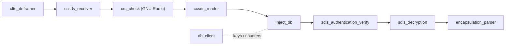

# gr-soarr

A GNU Radio out-of-tree module implementing the ground-station side of a
CCSDS Telecommand (TC) uplink for ARIS's SOARR mission: encode, secure,
frame, and transmit a telecommand on TX, and detect, correct, verify, and
decrypt it again on RX.

All 29 blocks are pure Python and appear in GNU Radio Companion under the
**[Soarr]** category: TC (Telecommand), by function (Frame, Randomizer,
BCH, CLTU, PLOP), TM (Telemetry), Common (shared by TC and TM: SDLS, Encapsulation, Key
Database), and Utilities.

## Features

- **CCSDS layering end to end** — encapsulation packet (CCSDS 133.1-B),
  TC transfer frame (CCSDS 232.0-B), pseudo-randomization, BCH (63,56)
  coding and CLTU framing (CCSDS 231.0-B).
- **SDLS security** (CCSDS 355.0-B-1) — AES-256-CTR encryption,
  AES-CMAC authentication, and the SDLS security header (SPI + IV).
- **BPSK modulator with both CCSDS PLOPs** — PLOP-1 bursts (transmitter
  off between CLTUs) or PLOP-2 continuous carrier, switchable while the
  flowgraph runs.
- **Key and counter management** — keys, SPIs, and per-frame counters come
  from a lookup block backed by an in-memory entry or a YAML file.
- **Full RX path** — CLTU detection, BCH error correction, frame
  reassembly, parsing, tag verification, decryption, and encapsulation
  packet parsing.
- **Ready-to-run examples** — software loopbacks and USRP transmitter,
  receiver, and loopback flowgraphs.
- **Loopback testing** — a payload generator and a tester reporting bit
  error rate, message error rate, and lost packets.

## Signal chains

### TX

```mermaid
flowchart LR
    db["db_client"] -. keys / counters .- inj["inject_db"]
    inj --> enc["encapsulation_header"] --> crypt["sdls_encryption"]
    crypt --> auth["sdls_authentication"] --> sh["sdls_header"]
    sh --> tc["tc_primary_header"] --> crc["crc_append (GNU Radio)"]
    crc --> scr["lfsr_scrambler"] --> bch["bch_encoder"]
    bch --> cltu["cltu_framer"] --> plop["plop_modulator (PLOP-1 / PLOP-2)"] --> sdr["SDR"]
```



### RX



The TX chain ends at `plop_modulator`, which BPSK-modulates the CLTUs for
the SDR in either CCSDS 231.0-B physical layer operations procedure,
switchable while the flowgraph runs:

- **PLOP-1** — each CLTU is one burst (acquisition sequence, CLTU, idle
  tail); the transmitter is off between bursts, which frees the TX/RX
  port for receiving.
- **PLOP-2** — continuous carrier with the idle sequence; each CLTU is
  inserted at the next byte boundary.

Either way a new CLTU waits behind at most one sample buffer (about 20 ms
at 400 kS/s), not behind queued idle bytes: in the software loopback
through the receiver chain, a frame arrives about 30–40 ms after its
airtime, in both modes and across mode switches.

For other modulators, `cltu_burst_builder` (PLOP-1 bursts through GNU
Radio's PDU to Tagged Stream) and `acquisition_idle_sequencer` (continuous
byte stream, with seconds of latency) provide the byte-level
equivalents.

Every block except `plop_modulator` and `acquisition_idle_sequencer`
passes PDUs as messages.
See [docs/architecture.md](docs/architecture.md) for the full pipeline
description.

## Blocks

| Block | GRC label | GRC category | Purpose |
|---|---|---|---|
| `inject_db` | Key Injector | Common / Key Database | Queries `db_client` and merges the returned keys and counters into each PDU's metadata |
| `key_database` | Key Database | Common / Key Database | Key Injector and Key Store in one block, the query loop inside |
| `db_client` | Key Store | Common / Key Database | Serves keys, SPIs, and counters by SCID + SPI from an in-memory entry or a YAML file |
| `encapsulation_header` | Encapsulation Header Adder | Common / Encapsulation | Prepends the CCSDS encapsulation packet header |
| `sdls_encryption` | SDLS Encryption | Common / SDLS | Encrypts the payload with AES-256-CTR |
| `sdls_authentication` | SDLS MAC Adder | Common / SDLS | Appends an AES-CMAC authentication tag |
| `sdls_header` | SDLS Header Adder | Common / SDLS | Prepends the SDLS security header (SPI + IV) |
| `sdls_apply` | SDLS Apply | Common / SDLS | SDLS ApplySecurity in one block: encryption, MAC, security header, by SDLS mode |
| `tc_frame_encoder` | TC Frame Encoder | TC | Data field to CLTU in one block: primary header, FECF, randomizer, BCH, CLTU sequences |
| `tc_primary_header` | TC Primary Header Adder | TC / Frame | Builds the 5-byte TC transfer frame primary header |
| `lfsr_scrambler` | TC Scrambler | TC / Randomizer | Applies the CCSDS TC pseudo-randomizer |
| `bch_encoder` | TC BCH Encoder | TC / BCH | Splits the frame into BCH (63,56) codewords |
| `cltu_framer` | TC CLTU Framer | TC / CLTU | Wraps codewords in the CLTU start and tail sequences |
| `plop_modulator` | TC PLOP Modulator | TC / PLOP | BPSK-modulates CLTUs for the SDR, PLOP-1 bursts or PLOP-2 continuous carrier, switchable at runtime |
| `cltu_burst_builder` | TC CLTU Burst Builder | TC / CLTU | Wraps each CLTU in acquisition sequence + idle tail as one transmission burst (PLOP-1) |
| `acquisition_idle_sequencer` | TC Acquisition and Idle Sequencer | TC / PLOP | Adds acquisition/idle sequences and outputs a continuous byte stream (PLOP-2) |
| `tc_frame_decoder` | TC Frame Decoder | TC | Received bits to parsed frames in one block: correlator, CLTU deframer, frame receiver, FECF check, frame parser |
| `cltu_deframer` | TC CLTU Deframer | TC / CLTU | Finds CLTUs in the received stream |
| `ccsds_receiver` | TC Frame Receiver | TC / Frame | BCH-corrects, de-randomizes, and reassembles TC transfer frames |
| `ccsds_reader` | TC Frame Parser | TC / Frame | Parses a reassembled frame into its header fields and payload |
| `sdls_authentication_verify` | SDLS MAC Verifier | Common / SDLS | Verifies and strips the AES-CMAC tag |
| `sdls_decryption` | SDLS Decryption | Common / SDLS | Decrypts the payload with AES-256-CTR |
| `sdls_process` | SDLS Process | Common / SDLS | SDLS ProcessSecurity in one block: MAC verification, decryption, by SDLS mode |
| `encapsulation_parser` | Encapsulation Parser | Common / Encapsulation | Strips the encapsulation packet header after decryption, header fields into the metadata |
| `bch_decoder` | TC BCH Decoder | TC / BCH | Standalone BCH (63,56) decoder (corrects 1 bit error, drops codewords with more) |
| `lfsr_descrambler` | TC Descrambler | TC / Randomizer | Standalone de-randomizer |
| `tm_randomizer` | TM Randomizer | TM / Randomizer | CCSDS TM pseudo-randomizer (17-bit LFSR, or legacy 8-bit LFSR), randomizes on TX and derandomizes on RX |
| `data_creator` | Data Creator | Utilities | Generates test payloads |
| `system_tester` | System Tester | Utilities | Measures bit error rate, message error rate, and lost packets in a loopback |

`bch_decoder` and `lfsr_descrambler` are also used internally by
`ccsds_receiver`; they are exposed separately for testing individual
layers. Each block has a requirements document in [docs/prd/](docs/prd/).

## Requirements

- GNU Radio 3.10 — developed and tested with 3.10.12 from
  [radioconda](https://github.com/ryanvolz/radioconda)
- CMake 3.16 or newer
- A C/C++ compiler (GCC, Clang, MSVC)
- Python packages from [requirements.txt](requirements.txt): `construct`,
  `PyYAML`, `pycryptodome`, `numpy`, and `pytest` for the tests

## Installation

Clone the repository, then install into your GNU Radio conda environment.

**Windows (PowerShell):**

```powershell
conda activate radioconda
pip install -r requirements.txt
.\tools\install_gr_soarr.ps1
```

**Linux / WSL** (Ubuntu shown; with a conda env, activate it and use
`pip install -r requirements.txt` instead of `apt`):

```bash
sudo apt install gnuradio gnuradio-dev cmake g++ \
    python3-construct python3-yaml python3-pycryptodome python3-pytest
./tools/install_gr_soarr.sh --sudo-install
```

Both scripts configure, build, and install the module into the active
environment. To run the CMake steps yourself instead:

```bash
cmake -S . -B build
cmake --build build --config Release
cmake --install build --config Release
```

CMake picks its default generator and whichever compiler it finds; add
`-G "<generator>"` to the first command to choose a specific one. Add the
install location to the first command as well:

- Windows with conda: `-DCMAKE_INSTALL_PREFIX=%CONDA_PREFIX%\Library -DGR_PYTHON_DIR=%CONDA_PREFIX%\Lib\site-packages`
  (conda keeps GNU Radio, and the folder GNU Radio Companion reads blocks
  from, under `Library`)
- Linux with conda: `-DCMAKE_INSTALL_PREFIX=$CONDA_PREFIX`
- Linux with GNU Radio from the package manager: the default `/usr/local`
  works as is

Afterwards, restart GNU Radio Companion; the blocks appear under
**[Soarr]**. Script options, VS Code setup, and troubleshooting are in
[docs/development.md](docs/development.md).

## Usage

The quickest start is the example flowgraphs in [examples/](examples/):
open `tc_loopback_sim.grc` in GNU Radio Companion and run it — it sends
TC frames through the whole TX and RX chain in software, no SDR needed.
`tc_loopback_plop_sim.grc` adds the BPSK modulation, a noisy channel, and
the demodulator, with a chooser to switch between PLOP-1 and PLOP-2.
`tc_tx_usrp.grc`, `tc_rx_usrp.grc` and `tc_loopback_usrp.grc` run over a
USRP; see [examples/README](examples/README).

To build your own flowgraph, wire the blocks as shown in the chains above.
From Python:

```python
from gnuradio import soarr

help(soarr)                # package overview
help(soarr.cltu_framer)    # ports, parameters, and PDU shapes of one block
```

[examples/db_client_example.yaml](examples/db_client_example.yaml) is an
example key/counter database for `db_client`; see
[examples/README](examples/README) for its format.

## Tests

```powershell
conda activate radioconda
pytest python/soarr -q
```

The suite covers every block individually plus TX/RX chain and
encrypt/decrypt, authenticate/verify round trips.

## Roadmap

- **Telemetry (TM)** — the downlink counterpart to TC is the next step.
  Only telecommand is implemented today; `ccsds_receiver` already has a
  TM message type option, but selecting it does not process frames yet.

## Known issues

- `db_client`'s dummy and YAML modes don't persist SDLS counters across
  restarts. Keeping counters unique over time is the job of the
  external key database that `db_client` will connect to.

Open bugs, design questions, and test-coverage gaps are tracked as
[GitHub issues](https://github.com/aris-space/soarr-groundstation-gnuradio/issues).

## Documentation

| Document | Contents |
|---|---|
| [docs/architecture.md](docs/architecture.md) | TX/RX pipeline and block roles |
| [docs/development.md](docs/development.md) | Build, install, test, tooling setup, and branch workflow |
| [docs/coding-standards.md](docs/coding-standards.md) | Naming, error handling, docstring, and commit rules |
| [docs/adr/](docs/adr/) | Architecture decision records |
| [docs/prd/](docs/prd/) | One requirements document per block |
| [SECURITY.md](SECURITY.md) | How to report a vulnerability privately |

## License

GPL-3.0-or-later — see [LICENSE](LICENSE).
